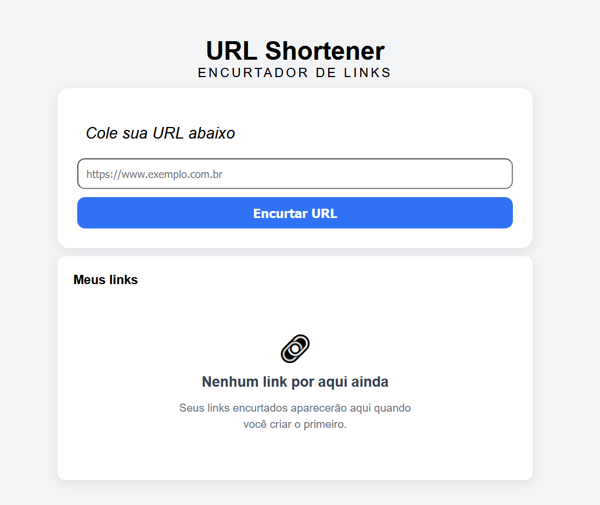

# URL Shortener


Uma aplicação web de encurtamento de URLs desenvolvida com Node.js, Express, PostgreSQL, HTML, CSS e JavaScript.

O projeto permite encurtar URLs, gerenciar os links cadastrados, redirecionar usuários para os endereços originais e acompanhar a quantidade de acessos de cada link.

Desenvolvido com o objetivo de praticar conceitos de desenvolvimento backend, construção de APIs REST, integração com banco de dados e consumo de APIs no frontend.

## Preview



## Tecnologias utilizadas

- **Node.js** — ambiente de execução JavaScript.
- **Express** — framework para construção da API.
- **PostgreSQL** — banco de dados relacional.
- **pg** — biblioteca para conexão com o PostgreSQL.
- **dotenv** — gerenciamento de variáveis de ambiente.
- **HTML5** — estrutura da interface.
- **CSS3** — estilização e responsividade.
- **JavaScript** — interações e consumo da API com Fetch.

## Funcionalidades


### Backend

- Encurtar URLs e gerar códigos de acesso.
- Validar URLs recebidas pela API.
- Evitar o cadastro duplicado de URLs.
- Redirecionar para a URL original utilizando o código gerado.
- Listar todas as URLs cadastradas.
- Contabilizar a quantidade de acessos de cada URL.
- Excluir URLs cadastradas pelo ID.

### Frontend

- Interface para cadastrar e encurtar URLs.
- Listagem automática dos links cadastrados.
- Exibição da URL original e do código encurtado.
- Identificação de URLs já cadastradas.
- Mensagens de sucesso, aviso e erro.
- Exclusão de links pela interface, com confirmação.
- Exibição de estado vazio quando não existem links cadastrados.

---

# Como executar o projeto

## Pré-requisitos

Antes de começar, você precisará ter instalado:

- [Node.js](https://nodejs.org/)
- [PostgreSQL](https://www.postgresql.org/download/)
- [Git](https://git-scm.com/)

## Instalação

### Clonando o repositório

Abra o terminal e execute:

```bash
git clone https://github.com/Guillhermegpp/UrlShortener.git
```

Entre na pasta do projeto:

```bash
cd UrlShortener
```

### Instalando as dependências

Execute o comando:

```bash
npm install
```

Esse comando instala todas as dependências necessárias, definidas no arquivo `package.json`.

### Configurando as variáveis de ambiente

Na raiz do projeto, crie um arquivo chamado `.env` e configure as seguintes variáveis:

```env
DB_HOST=localhost
DB_PORT=5432
DB_USER=seu_usuario
DB_PASSWORD=sua_senha
DB_NAME=url_shortener
```

**Atenção:** substitua `seu_usuario` e `sua_senha` pelas credenciais utilizadas na sua instalação do PostgreSQL.

Não compartilhe seu arquivo `.env` no GitHub. Ele contém informações sensíveis de acesso ao banco de dados.

### Configurando o banco de dados

Com o PostgreSQL instalado e em execução, acesse o banco de dados e execute os comandos SQL abaixo.

**1. Criar o banco de dados:**

```sql
CREATE DATABASE url_shortener;
```

**2. Conectar-se ao banco `url_shortener` e criar a tabela:**

```sql
CREATE TABLE urls (
    id INT GENERATED ALWAYS AS IDENTITY PRIMARY KEY,
    url_original VARCHAR(2083) NOT NULL,
    codigo VARCHAR(10) NOT NULL,
    acessos INT NOT NULL DEFAULT 0,
    criado_em TIMESTAMP NOT NULL DEFAULT CURRENT_TIMESTAMP
);
```

**3. Criar as restrições de unicidade:**

```sql
ALTER TABLE urls
ADD CONSTRAINT urls_codigo_unique UNIQUE (codigo);

ALTER TABLE urls
ADD CONSTRAINT urls_url_original_unique UNIQUE (url_original);
```

**Documentação complementar:** [PostgreSQL_URL_Shortener.docx](./PostgreSQL_URL_Shortener.docx)

O arquivo contém consultas SQL utilizadas no desenvolvimento e na manutenção do banco de dados.

### Iniciando o servidor

Após configurar o banco de dados e as variáveis de ambiente, execute:

```bash
node server.js
```

O servidor será iniciado na porta `3000`.

Para verificar se está funcionando, acesse:

http://localhost:3000

A resposta esperada será:

```text
Servidor funcionando
```

## Rotas da API

| Método | Rota | Descrição |
|:---:|---|---|
| GET | `/` | Verifica se o servidor está funcionando. |
| POST | `/urls` | Cria uma URL encurtada. |
| GET | `/urls` | Lista todas as URLs cadastradas. |
| GET | `/:codigo` | Redireciona para a URL original. |
| DELETE | `/urls/:id` | Exclui uma URL pelo ID. |

### Exemplos de utilização

**Criar uma URL encurtada**

`POST /urls`

Corpo da requisição:

```json
{
    "url": "https://www.google.com"
}
```

**Listar URLs cadastradas**

`GET /urls`

**Acessar uma URL encurtada**

`GET /:codigo`

**Excluir uma URL**

`DELETE /urls/:id`

## Executando o Frontend

Após iniciar o servidor backend, siga os passos:
1. Abra a pasta frontend no VS Code.
2. Abra o arquivo index.html.
3. Execute o arquivo utilizando a extensão Live Server.
4. A aplicação será aberta no navegador.
5. O frontend se comunica com a API através de requisições HTTP para http://localhost:3000.

**Importante**: mantenha o servidor backend em execução enquanto utiliza a interface.

## Testando a API pelo PowerShell

Com o servidor em execução, abra outro terminal PowerShell e utilize o comando abaixo para cadastrar uma URL:

```powershell
Invoke-RestMethod -Method Post -Uri "http://localhost:3000/urls" -ContentType "application/json" -Body '{"url":"https://www.google.com"}'
```

O comando envia uma requisição POST para a API, com a URL original no corpo da requisição.

Para listar as URLs cadastradas:

```powershell
Invoke-RestMethod -Method Get -Uri "http://localhost:3000/urls"
```

Para excluir uma URL pelo ID:

```powershell
Invoke-RestMethod -Method Delete -Uri "http://localhost:3000/urls/1"
```

Para testar o redirecionamento, acesse no navegador:

```text
http://localhost:3000/CODIGO_GERADO
```

## Estrutura do projeto

```text
UrlShortener/
│
├── frontend/
│   ├── index.html
│   ├── style.css
│   └── script.js
│
├── server.js
├── package.json
├── package-lock.json
├── .gitignore
├── .env
├── PostgreSQL_URL_Shortener.docx
└── README.md
```


# Aprendizados

- Desenvolvimento de API REST com Express.
- Integração com PostgreSQL.
- Tratamento de erros e validação de dados.
- Operações CRUD.
- Consumo de API utilizando Fetch.
- Manipulação dinâmica do DOM.
- Programação assíncrona com async/await.